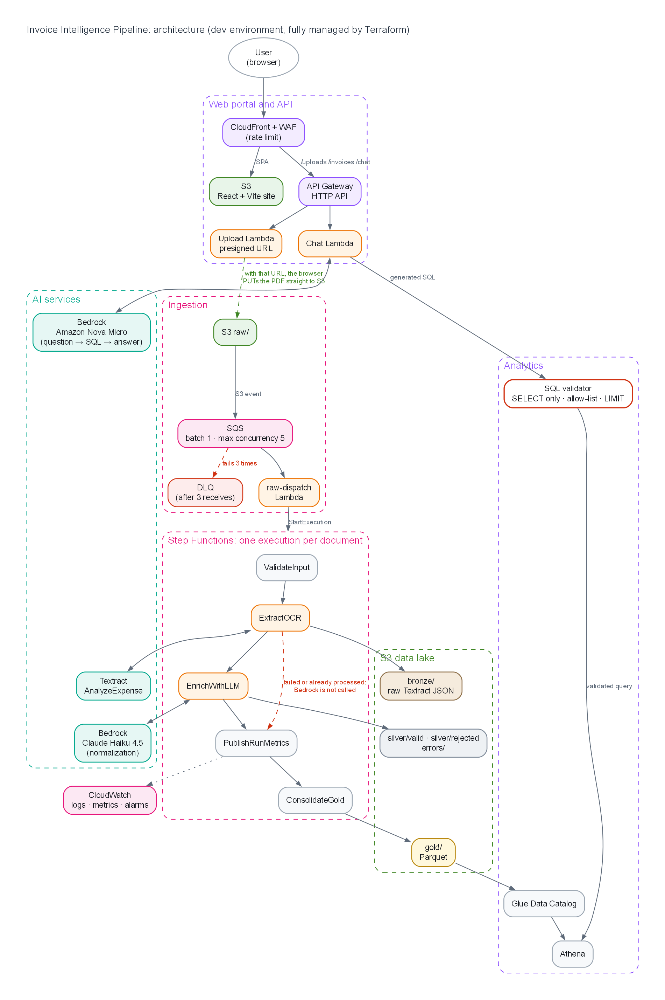

# Invoice Intelligence Pipeline

## Overview

Invoice Intelligence Pipeline is a complete serverless Data Product on AWS: a
user uploads a PDF invoice through a web portal, the pipeline extracts and
enriches it with Textract and Bedrock, consolidates it into a Gold analytics
layer, and the user can immediately query their invoices with natural language
and receive business-friendly answers.

The project is an end-to-end MVP that covers Data Engineering, OCR, Lakehouse
Architecture, GenAI, Conversational Analytics, and Infrastructure as Code
(Terraform), without hiding any runtime behavior behind a framework. It runs in
a single `dev` environment; see [Limitations](#limitations).

## Business Problem

Invoice operations often start with semi-structured files and end with manual
review, inconsistent fields, and limited traceability. This project turns raw
invoice files into inspectable data lake outputs with explicit accepted,
rejected, and failed outcomes — and exposes them through a conversational
analytics interface any non-technical user can operate.

## MVP2 User Journey

1. Open the web portal (CloudFront HTTPS URL).
2. Upload one or more PDF invoices via the Upload page.
3. Watch processing status transition: `Uploaded → Processing → Consolidating → Completed`.
4. Switch to the Chat tab and ask a natural-language question about the invoices.
5. Receive a Bedrock-generated answer backed by a live Athena query.

## Solution Architecture

```text
Browser
  └─ CloudFront + WAF (rate-limit)
       ├─ S3 Static Site (React + Vite SPA)
       └─ API Gateway HTTP API v2
            ├─ POST /uploads  → presigned S3 PUT (raw/ prefix triggers pipeline)
            ├─ GET  /invoices → paginated status list (S3 status/ store)
            ├─ GET  /invoices/{id}/status
            └─ POST /chat     → Bedrock NL→SQL → Athena → Bedrock NL answer

S3 raw/ → SQS → Lambda raw-dispatch → Step Functions:
  ValidateInput → ExtractOCR (Textract) → EnrichWithLLM (Bedrock)
    → PublishRunMetrics → ConsolidateGold → Completed status
  Gold Parquet → Glue Catalog → Athena workgroup
```

## Key Features

- Serverless web portal (React + Vite) hosted on S3 + CloudFront + WAF.
- HTTP upload API with presigned S3 PUT URLs; browser uploads directly to S3.
- Per-invoice status tracking (`Uploaded → Processing → Consolidating → Completed | Failed`).
- Automated Gold consolidation wired into Step Functions (SPEC-016) so every
  completed invoice is immediately queryable in Athena.
- Conversational analytics: natural-language question → Bedrock SQL generation
  → validated Athena query → Bedrock NL answer.
- Semantic Gold dataset (`gold_invoice_summary`) with business-friendly column
  names for better NL→SQL accuracy (SPEC-012).
- Remote Terraform state backend in S3 with native locking (Terraform ≥ 1.10).
- S3 data lake prefixes for raw, bronze, silver, gold, manifests, errors, and status.
- SQS buffering with DLQ routing and CloudWatch alarms for DLQ depth, Lambda
  errors, and Step Functions failures.
- Canonical contracts, quality rules, metrics, and prompts under `specs/`.
- Explicit `make` workflow for packaging, Terraform, and frontend deployment.

## Extension Features

- Pluggable LLM model selection so enrichment and NL→SQL can use different
  Bedrock models as needs evolve.
- Glue job replacement path for Lambda stages when document volume exceeds
  Lambda processing limits.
- Data warehouse consolidation path for publishing Gold data into Redshift,
  Snowflake, or another warehouse.

## Architecture Diagram



The overview above is generated from
[`docs/resources/architecture_overview.dot`](docs/resources/architecture_overview.dot).
For edge-by-edge detail see [`architecture.dot`](docs/resources/architecture.dot),
and for Mermaid diagrams of the pipeline flow, AWS service topology and layers
see [`docs/resources/diagram.md`](docs/resources/diagram.md).

## Design Decisions

Each decision below was a trade-off made under the constraints of a
single-maintainer, low-budget, fully-serverless project.

| Decision | Why | What it costs |
|---|---|---|
| Textract does OCR; the LLM only normalizes text ([SPEC-006](specs/SPEC-006-ocr-llm-separation.md)) | Separates deterministic extraction from probabilistic interpretation; the raw Textract JSON in `bronze/` shows whether a bad field came from reading or from interpretation | Two services to integrate and pay for |
| OCR and LLM run as separate Lambda steps in Step Functions | A Bedrock failure never re-pays for OCR; each step has its own least-privilege IAM role (the OCR role cannot call Bedrock and vice versa) | More Lambdas, roles and Terraform modules |
| SQS buffer with DLQ and an idempotency guard in front of Step Functions | Bounded concurrency for Textract/Bedrock; failed messages are kept, not lost | One more hop; the idempotency `HeadObject` check needs `s3:ListBucket` on the prefix, otherwise S3 returns `403` instead of `404` for missing keys ([AWS docs](https://docs.aws.amazon.com/AmazonS3/latest/API/API_HeadObject.html)) |
| Models chosen by measurement ([report](docs/model_comparison_report.md)) | Neither call uses vision or tools, so cheaper models were viable if accuracy held on the real prompt and validator | A small, hand-labelled evaluation set to maintain |
| LLM-generated SQL always passes an allow-list validator | Free-text questions become SQL against the lake; the validator, an IAM role that can only read Gold (plus write Athena results) and an Athena per-query scan cutoff (100 MB) bound the blast radius | Rigid: new Gold columns must be registered, and some legitimate questions are refused |

## Model Selection

Both Bedrock call sites originally used Claude Sonnet 4.5. A small evaluation
harness ([`tests/model_comparison/`](tests/model_comparison/)) ran the
production prompts against hand-labelled cases (September 2026, on-demand list
prices, single run per case):

| Call site | Model | Accuracy | Avg cost / call | Avg latency |
|---|---|---|---|---|
| Invoice normalization (8 invoices × 5 fields) | Claude Sonnet 4.5 | 39/40 fields | $0.004905 | 4,283 ms |
| | **Claude Haiku 4.5** (deployed) | **40/40 fields** | $0.001630 | 1,922 ms |
| | Amazon Nova Lite | 38/40 fields | $0.000061 | 812 ms |
| Question → SQL (8 questions, validator-passing) | Claude Sonnet 4.5 | 8/8 | $0.005061 | 2,161 ms |
| | **Amazon Nova Micro** (deployed) | **8/8** | $0.000052 | 502 ms |

With eight cases per task this shows the cheaper models are not clearly worse
for these prompts; it does not show they are equivalent on production-scale
variety. Methodology, per-case misses and the prompt fixes that got NL→SQL to
8/8 are in the [full report](docs/model_comparison_report.md).

## Cost

- **Guardrail:** an AWS Budget of USD 20/month is provisioned by Terraform
  ([`budget.tf`](infra/envs/dev/budget.tf)).
- **Measured LLM cost:** about USD 1.63 per 1,000 invoices for normalization
  and USD 0.52 per 10,000 chat questions (see Model Selection).
- **Not measured:** total monthly cost from Cost Explorer. Textract
  `AnalyzeExpense` is billed per page; check current
  [Textract pricing](https://aws.amazon.com/textract/pricing/) before running
  large batches.

## Demo

The following recordings show the data product running end-to-end on AWS:

- [Demo 1: invoice upload and pipeline processing (MP4)](docs/video/invoice%20pipeline_demo.mp4)
- [Demo 2: conversational analytics, natural-language query via chat (MP4)](docs/video/invoice%20pipeline_demo2.mp4)

## Repository Structure

```text
ai/                 Agent guidance, skills, and context configuration
artifacts/lambda/   Generated Lambda deployment bundles
docs/               Architecture notes, runbooks, deployment history, and diagrams
frontend/           React + Vite SPA (upload, history, chat UI)
infra/bootstrap/    One-time S3 remote-state bucket provisioning stack
infra/envs/dev/     Executable Terraform entrypoint for the AWS dev environment
infra/modules/      Focused reusable Terraform modules
scripts/quality/    Ruff lint and format wrappers
scripts/windows/    Windows setup and Makefile wrapper helpers
specs/              Contracts, quality rules, metrics, prompts, and design specs
src/                Python pipeline, Lambda handlers, and analytics code
```

The older `infra/` root stack is kept as a transition baseline. New work
targets `infra/envs/dev`.

## Data Lake Layers

- `raw/`: source documents uploaded directly or under `run_id=<run_id>`.
- `bronze/textract-json/`: Textract technical evidence and extraction metadata.
- `silver/valid/`: canonical accepted documents.
- `silver/rejected/`: canonical documents rejected by quality or business rules.
- `errors/`: technical processing failures and failed silver documents.
- `gold/documents/batch_id=<batch_id>/`: curated Parquet snapshots for Athena.
- `gold/manifests/batch_id=<batch_id>/`: batch manifests kept outside the table
  prefix.

## Gold Analytics Layer

The Gold layer is provisioned in
[`infra/envs/dev/analytics.tf`](infra/envs/dev/analytics.tf) and includes:

- a Glue database `invoice_pipeline_gold`,
- an external table `gold_documents` partitioned by `batch_id`,
- an Athena workgroup `invoice-pipeline-dev` with per-query scan limits,
- a Python analytics CLI under [`src/analytics/`](src/analytics/).

Example usage after deployment:

```powershell
$lake = terraform -chdir=infra/envs/dev output -raw data_lake_bucket_name
$env:ATHENA_OUTPUT_LOCATION = "s3://$lake/athena-results/"
$env:BEDROCK_MODEL_ID = "amazon.nova-micro-v1:0"

python -m src.analytics.cli repair-partitions
python -m src.analytics.cli sql "SELECT vendor_name, COUNT(document_id) AS docs FROM gold_documents GROUP BY vendor_name"
python -m src.analytics.cli ask "How many accepted invoices per vendor in the latest batch?"
```

Generated SQL is validated by
[`src/analytics/sql_validator.py`](src/analytics/sql_validator.py). It accepts
only single `SELECT` statements, rejects unsafe operations, limits references to
known schema objects, and enforces a bounded `LIMIT`.

## Specs And Design Records

Specs and decision records live in [`specs/`](specs/). Key references include:

- [`SPEC-004-runtime-iam-validation.md`](specs/SPEC-004-runtime-iam-validation.md)
- [`SPEC-005-structured-logging.md`](specs/SPEC-005-structured-logging.md)
- [`SPEC-006-ocr-llm-separation.md`](specs/SPEC-006-ocr-llm-separation.md)
- [`SPEC-007-terraform-remote-state.md`](specs/SPEC-007-terraform-remote-state.md)
- [`SPEC-008-analythic-layer.md`](specs/SPEC-008-analythic-layer.md)
- [`specs/contracts/`](specs/contracts/) for canonical document schemas
- [`specs/quality/`](specs/quality/) for bronze, silver, and gold rules
- [`specs/metrics/pipeline_metrics.yaml`](specs/metrics/pipeline_metrics.yaml)
  for metrics expectations

## Development And Packaging

This repository uses Python 3.11+ and `uv`.

```powershell
make init
make lint
make fmt
make package
```

On restricted Windows environments, use the wrapper flow documented under
[`docs/windows_setup/`](docs/windows_setup/), for example:

```powershell
.\scripts\windows\run_make.ps1 package
```

The Lambda bundle is generated at
`artifacts/lambda/control_plane_bundle.zip`. Lambda-only dependencies are listed
in [`requirements.lambda.txt`](requirements.lambda.txt).

## Terraform Deployment

The active dev stack is under [`infra/envs/dev`](infra/envs/dev/README.md).
Typical planning commands are:

```powershell
.\.venv\Scripts\python.exe scripts\package.py --package-manager uv
terraform -chdir=infra/envs/dev init -backend=false
terraform -chdir=infra/envs/dev validate
terraform -chdir=infra/envs/dev plan -var-file=terraform.tfvars.example
```

For a real deployment, create the artifact bucket first, upload
`artifacts/lambda/control_plane_bundle.zip` to the configured artifact key, then
plan and apply the stack. Do not run `terraform apply` without explicit approval
and a reviewed plan.

Remote state is prepared through `backend.tf.example`; copy it to `backend.tf`
only when the backend bucket and state policy are intentionally configured.

The full step-by-step deployment is in
[`docs/deployment_guide.md`](docs/deployment_guide.md).

### Teardown

The environment is designed to be destroyed completely. Read
[`docs/destruction_guide.md`](docs/destruction_guide.md) first: the data lake,
artifact and site buckets use `force_destroy = true`, so `terraform destroy`
deletes all pipeline data without a further prompt.

## Operational Validation

After deployment, trigger the pipeline by uploading a supported document to the
raw prefix:

```powershell
$lake = terraform -chdir=infra/envs/dev output -raw data_lake_bucket_name
aws s3 cp .\data\raw\0000089370.tif s3://$lake/raw/run_id=run-001/0000089370.tif
```

Use CloudWatch Logs, Step Functions execution history, S3 output prefixes, Glue
partitions, and Athena queries to inspect results end to end.

## Current Status

The MVP is complete end-to-end. The full cycle — web portal upload through
conversational analytics — is deployed and validated on AWS:

- Serverless web portal (React + Vite) on S3 + CloudFront + WAF.
- HTTP API (API Gateway v2) with `/uploads`, `/invoices`, `/invoices/{id}/status`,
  and `/chat` endpoints.
- Upload Lambda generating presigned S3 PUT URLs; browser uploads directly to S3.
- Per-document status tracking in `status/` with transitions
  `Uploaded → Processing → Consolidating → Completed | Failed`.
- Step Functions pipeline: `ValidateInput → ExtractOCR → EnrichWithLLM →
  PublishRunMetrics → ConsolidateGold` fully wired (SPEC-016).
- Conversational analytics: `POST /chat` accepts a natural-language question,
  generates and validates SQL via Bedrock, queries Athena, and returns a
  Bedrock-summarized answer.
- Bronze, Silver, Gold, and error routing with `run_id` traceability.
- CloudWatch logs, custom metrics, and a $20/month AWS Budget guardrail.
- Bedrock models: Claude Haiku 4.5 for invoice normalization, Amazon Nova Micro
  for NL→SQL and answers.

## Sample Data

The sample invoices used for development and testing are scanned TIF images
from the *invoice* class of the
[RVL-CDIP dataset](https://adamharley.com/rvl-cdip/) (A. W. Harley, A. Ufkes,
K. G. Derpanis, *Evaluation of Deep Convolutional Nets for Document Image
Classification and Retrieval*, ICDAR 2015), downloaded from a Kaggle mirror.
They are 1980s business documents from the public Legacy Tobacco Documents
Library. The images are not redistributed here: `data/` is git-ignored.

## Limitations

- Single `dev` environment; no staging or production promotion yet.
- Model evaluation uses 8 hand-labelled cases per task and one run per case.
- The largest load test so far was a 40-document smoke run.
- Rejected or failed documents cannot yet be reprocessed selectively.

## Roadmap

- Harden CloudWatch alarms, Lambda retries, and DLQ alerting.
- Selective reprocessing for failed or rejected documents.
- Widen the model evaluation set beyond 8 cases per task.
- Environment promotion beyond dev (staging, production stacks).
- Optional: QuickSight or BI tool integration in direct-query mode over Athena.

## License

This project is licensed under the MIT License. See [`LICENSE`](LICENSE).
